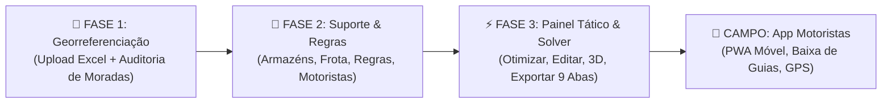

# 🚚 GeoRoutePlan — Documento Oficial de Especificação, Princípios e Arquitetura

> **🚨 REGRA SUPREMA PARA O AGENTE DE IA / DESENVOLVEDOR:**
> Este é o documento mestre de referência absoluta do projeto. **Todas as sessões de trabalho devem começar pela leitura e alinhamento rigoroso com as especificações aqui descritas.** Não altere código, modelos ou arquitetura sem validar a sua conformidade contra este documento.

---

## 📌 1. Visão Geral e Filosofia do Sistema

O **GeoRoutePlan** (GEORREF Optimizer) é uma plataforma empresarial integrada de georreferenciação inteligente, otimização de rotas de distribuição logística (*Vehicle Routing Problem* - VRP), controlo operacional tático em tempo real e aplicação móvel de campo para motoristas.

### Princípios Invioláveis:

1. **Eficiência de Custos (*Low-Cost Waterfall First*)**:
   * O sistema nunca faz chamadas desnecessárias a APIs pagas.
   * **Cascata Obrigatória de Geocoding**:
     1. Base de Dados Local SQLite (Códigos postais e histórico de moradas geocodificadas).
     2. Web Scraping / Base CTT.
     3. OpenStreetMap (OSM Nominatim).
     4. **Google Maps API**: Usada apenas como último recurso para moradas não resolvidas, renderização avançada de mapas, trânsito em tempo real e cálculo de matrizes de distância de alta precisão.
   * **🚨 DIRETRIZ DE ATIVAÇÃO DE APIS PAGAS DE TRÂNSITO (IMPORTANTE)**:
     * A integração avançada de matrizes de trânsito em tempo real via **Google Routes Matrix API está devidamente planeada e desenhada**, mas **NÃO PODE SER IMPLEMENTADA até existirem clientes comerciais reais e pagantes no sistema**.
     * Enquanto não houver clientes reais a justificar o custo operacional da API, o motor de planeamento mantém-se a **custo zero** utilizando o solver local **Google OR-Tools com matrizes Haversine calibradas e regras de negócio locais**.

2. **Google Maps API Centralizada e Otimizada**:
   * A API do Google Maps está integrada no sistema para geocoding de alta precisão (níveis 0-2), polylines reais e visualização em mapas.
   * Todo o consumo é monitorizado e contabilizado por empresa/cliente no painel de administração (`admin/consumptions`).

3. **O Ficheiro Excel como Entrada e Arquivo Final (*Single Source of Truth*)**:
   * **Papéis Claros de Arquitetura**: O **Ficheiro Excel de 9 Abas** é o formato canónico de entrada e o arquivo oficial de saída; a **base de dados SQLite** guarda o estado temporário de trabalho e cálculo no servidor.
   * **Modelo Soberano e Fechado**: O produto segue estritamente o seu modelo canónico oficial. O nosso ficheiro não suporta abas ou colunas arbitrárias adicionais criadas pelos clientes; quaisquer requisitos específicos de clientes fora do contrato canónico devem ser tratados através de desenvolvimentos ou integrações dedicadas.
   * **Importação Total & Transacional**: O sistema valida e importa todos os campos de todas as 9 abas. Se o ficheiro já contiver rotas na aba `Rotas`, recria-as de imediato.
   * **O Que Entra Tem de Sair**: Nenhuma entidade (viatura, motorista, cliente) é apagada definitivamente do ficheiro por estar inoperacional naquele dia. Em vez de eliminar, o sistema inativa (`is_active = 0`); ao exportar, continuam na lista para que o cliente não tenha de voltar a escrevê-los no dia seguinte.
   * **Preservação Fiel Sem Dados Inventados**: Campos vazios no Excel de origem (ex: peso ou volume não preenchido) mantêm-se a 0/vazios e são assinalados visualmente a cor de aviso no ecrã para o operador corrigir, sem nunca inventar números artificiais que adulterem a faturação do cliente.
   * **Exportação Fiel (*Roundtrip*) num Novo Ficheiro**: Ao descarregar, o sistema não grava por cima do ficheiro binário original recebido. O motor gera um **novo ficheiro Excel canónico**, formatado e batizado com o nome da distribuição, data e hora da extração (ex: `GeoRoutePlan_<NomeDistribuição>_YYYYMMDD_HHMMSS.xlsx`), com as **9 abas totalmente preenchidas e atualizadas** com o estado exato da operação.

4. **Idioma e Comunicação**:
   * Toda a documentação, comentários de código estruturais e comunicação devem ser em **Português**.

5. **Uso Obrigatório de SKILLs Especializadas**:
   * Antes de executar tarefas em qualquer camada técnica (Frontend Next.js, Backend FastAPI, Algoritmos OR-Tools, Mobile/PWA, Base de Dados), deve ser invocada e seguida a respetiva SKILL da área.

---

## 📊 2. Estrutura Canónica e Campos Reais do Ficheiro Excel (9 Abas)

O ficheiro Excel do projeto (`GeoRoutePlan.xlsx`) é composto por 9 abas interligadas. Os nomes das abas e as suas colunas correspondem rigorosamente à implementação real do sistema:

### 1. `Armazéns` (Centros de Distribuição / Depósitos)
| Coluna | Tipo / Importância | Descrição / Exemplo |
| :--- | :---: | :--- |
| `Nome_Armazem` | **Obrigatório** | Identificador único do armazém (ex: *Armazém Central Lisboa*) |
| `Morada` | **Obrigatório** | Endereço completo do armazém (ex: *Rua do Cais, 100*) |
| `CP` | **Obrigatório** | Código postal de 4 ou 7 dígitos (ex: *1900-100*) |
| `Localidade` | Opcional | Localidade / Povoação (ex: *Lisboa*) |
| `Latitude` | Opcional | Coordenada Latitude (ex: *38.7436*) |
| `Longitude` | Opcional | Coordenada Longitude (ex: *-9.1602*) |
| `Hora_Abertura` | Recomendado | Horário de início de operações (ex: *07:00*) |
| `Hora_Fecho` | Recomendado | Horário de encerramento do armazém (ex: *20:00*) |
| `Tempo_Carga_Min` | Recomendado | Duração média de carregamento da viatura em minutos (ex: *30*) |
| `Contacto_Responsavel`| Recomendado | Nome e telemóvel do responsável do cais |

### 2. `Frota` (Veículos e Capacidades Operacionais)
| Coluna | Tipo / Importância | Descrição / Exemplo |
| :--- | :---: | :--- |
| `Armazem` | **Obrigatório** | Nome do armazém base associado (ex: *Armazém Central Lisboa*) |
| `Veiculo` | **Obrigatório** | Nome/Código do veículo ou rota (ex: *Carrinha 01 - Lisboa*) |
| `Capacidade_KG` | **Obrigatório** | Capacidade máxima de carga em KG (ex: *1200*) |
| `Capacidade_Vol` | Recomendado | Capacidade máxima em volume / m³ (ex: *10.5*) |
| `Velocidade_Media` | Recomendado | Velocidade média de circulação em km/h (ex: *45*) |
| `Hora_Inicio_Turno` | **Obrigatório** | Hora de início de turno do motorista (ex: *08:00*) |
| `Hora_Fim_Turno` | **Obrigatório** | Hora limite de fim de turno do motorista (ex: *17:00*) |
| `Custo_KM` | Recomendado | Custo operacional por quilómetro (€/km) (ex: *0.65*) |
| `Custo_Hora` | Recomendado | Custo operacional por hora (€/h) (ex: *12.00*) |
| `Max_Entregas` | Recomendado | Número máximo de paragens permitidas por turno (ex: *25*) |
| `Regras` | Opcional | Tags de restrição da viatura (ex: *[FRIO], [PESADOS], [CENTRO_URBANO]*) |
| `2ª Volta` | Opcional | Permite 2ª volta / recarga no armazém no mesmo dia (*Sim* ou *Não*) |
| `Motorista_Nome` | Recomendado | Nome do condutor principal atribuído |
| `Motorista_Telemovel`| Recomendado | Contacto telefónico do condutor |

### 3. `Entregas` (Lista de Clientes e Encomendas)
| Coluna | Tipo / Importância | Descrição / Exemplo |
| :--- | :---: | :--- |
| `Armazem` | **Obrigatório** | Armazém que abastece a entrega |
| `Doc_ID` | **Obrigatório** | Número da guia/fatura/documento (ex: *FT-2026/001*) |
| `Cliente` | **Obrigatório** | Nome ou código do cliente (ex: *Restaurante Mar e Sol*) |
| `Morada` | **Obrigatório** | Endereço completo da paragem (ex: *Avenida da Liberdade, 24*) |
| `CP` | **Obrigatório** | Código postal CP4 ou CP7 (ex: *1250-096*) |
| `Localidade` | Opcional | Localidade / Freguesia / Concelho |
| `Latitude` | Opcional | Coordenada Latitude geocodificada |
| `Longitude` | Opcional | Coordenada Longitude geocodificada |
| `Telefone_Cliente` | Recomendado | Telefone para contacto na entrega |
| `Peso_KG` | Recomendado | Peso total da encomenda em KG (ex: *45.5*) |
| `Volume_M3` | Recomendado | Volume total em metros cúbicos (ex: *0.8*) |
| `Janela1_Inicio` | **Obrigatório** | Início da janela horária de receção (ex: *09:00*) |
| `Janela1_Fim` | **Obrigatório** | Fim da janela horária de receção (ex: *12:30*) |
| `Tempo_Descarga_Min`| Recomendado | Duração prevista para descarga no cliente (ex: *15*) |
| `Regras` | Opcional | Tags de exigência da entrega (ex: *[FRIO], [ELEVADOR], [ACESSO_RESTRITO]*) |
| `Vendedor` | Opcional | Nome/Código do comercial responsável pela conta |
| `Valor_Cobrar` | Opcional | Valor de cobrança no ato de entrega / COD (€) |
| `Notas_Entrega` | Opcional | Instruções de acesso ou observações logísticas |

### 4. `Regras` (Matriz de Compatibilidade e Restrições)
| Coluna | Tipo / Importância | Descrição / Exemplo |
| :--- | :---: | :--- |
| `Tag_Veiculo` | **Obrigatório** | Tag associada à viatura (ex: *CARRINHA_PEQUENA*) |
| `Permissao` | **Obrigatório** | Tipo de regra (*PERMITIR* ou *PROIBIR*) |
| `Tag_Entrega` | **Obrigatório** | Tag associada à entrega/cliente (ex: *ACESSO_RESTRITO_LX*) |
| `Descricao` | Opcional | Explicação detalhada da regra de negócio |

### 5. `Rotas` (Rotas Planeadas e Sequência de Paragens)
| Coluna | Tipo / Importância | Descrição / Exemplo |
| :--- | :---: | :--- |
| `ID_Original` | **Obrigatório** | Doc_ID ou identificador único da paragem |
| `Cliente` | **Obrigatório** | Nome do cliente |
| `Morada` | **Obrigatório** | Morada da paragem |
| `Localidade` | **Obrigatório** | Localidade da entrega |
| `CodPostal` | **Obrigatório** | Código postal |
| `Rota` | Recomendado | Nome da rota / Veículo atribuído (ex: *Carrinha 01*) |
| `Ordem` | Recomendado | Posição sequencial na rota (1, 2, 3...) |
| `Janela_Inicio` | Recomendado | Horário previsto de chegada |
| `Janela_Fim` | Recomendado | Horário limite de saída |
| `Peso` | Recomendado | Peso da entrega (KG) |
| `Volumes` | Recomendado | Volume da entrega (m³) |
| `Contacto` | Recomendado | Telefone de contacto |
| `Vendedor` | Opcional | Vendedor associado |
| `Valor_Cobrar` | Opcional | Valor a cobrar na paragem (€) |
| `Observações` | Opcional | Notas da rota ou do motorista |

### 6. `Manifestos` (Resumo Operacional de Carga por Veículo)
| Coluna | Tipo / Importância | Descrição / Exemplo |
| :--- | :---: | :--- |
| `Armazem` | Manifesto | Armazém de partida |
| `Veiculo` | Manifesto | Identificador da viatura |
| `Motorista` | Manifesto | Nome do condutor |
| `Total_Paragens` | Manifesto | Número total de paragens da rota |
| `Volume_Total_M3` | Manifesto | Volume total carregado (m³) |
| `Peso_Total_KG` | Manifesto | Peso total carregado (KG) |
| `Taxa_Ocupacao_Peso`| Manifesto | % de ocupação da viatura face à capacidade máxima |
| `Distancia_Total_KM`| Manifesto | Quilometragem total estimada da rota |
| `Tempo_Total_Estimado`| Manifesto| Duração total estimada do turno |
| `Custo_Total_Estimado`| Manifesto| Custo financeiro estimado da rota (€) |
| `Lista_Documentos` | Opcional | Lista concatenada de números de guias/faturas |

### 7. `Motoristas e Carros` (Credenciais Móveis e Viaturas)
| Coluna | Tipo / Importância | Descrição / Exemplo |
| :--- | :---: | :--- |
| `Motorista` | **Obrigatório** | Nome completo do motorista |
| `PIN/Password` | **Obrigatório** | PIN de autenticação para a App Móvel (ex: *1111*) |
| `Viatura` | Recomendado | Nome da viatura associada |
| `Matrícula` | Opcional | Matrícula da viatura (ex: *AA-00-BB*) |
| `Telemóvel` | Recomendado | Número de telefone do motorista |
| `Rota Atribuída` | Opcional | Identificador da rota em execução |

### 8. `Justificação entregas` (Catálogo de Motivos de Não Entrega)
| Coluna | Tipo / Importância | Descrição / Exemplo |
| :--- | :---: | :--- |
| `Motivo de Não Entrega` | **Obrigatório** | Descrição do motivo (ex: *Cliente Ausente*, *Carga Recusada*, *Morada Incorreta*, *Estabelecimento Encerrado*) |
| `Categoria / Ação` | Recomendado | Ação operacional recomendada (ex: *Reagendar*, *Devolver ao Armazém*, *Contactar Comercial*) |

### 9. `Instruções` (Legenda e Regras de Preenchimento)
| Coluna | Tipo / Importância | Descrição |
| :--- | :---: | :--- |
| `Secção` | Instruções | Identificador da aba ou módulo |
| `Campo_ou_Regra` | Instruções | Nome da coluna ou parâmetro |
| `Obrigatorio` | Instruções | Nível de exigência (*Sim*, *Recomendado*, *Opcional*) |
| `Formato_Aceite` | Instruções | Tipo de dados aceite (Texto, Numérico, HH:MM, etc.) |
| `Exemplo` | Instruções | Valor de exemplo representativo |
| `Descricao_e_Recomendacoes`| Instruções| Guia detalhado de boas práticas |

---

## 🖥️ 3. Manual de Operação e Instruções Passo a Passo (Como Usar o Programa)

> **💡 NOTA PARA APLICAÇÃO:** Este capítulo serve de base direta para a página de **"Ajuda / Instruções Interativas"** embutida no frontend da aplicação para orientar qualquer operador logístico ou gestor de tráfego.

O fluxo de trabalho no GeoRoutePlan está desenhado em **3 Fases Sequenciais**, com ferramentas táticas de suporte:

### 🚀 Fluxo de Trabalho Operacional (Fases 1, 2 e 3):

---

### Passo 1: Criação de Projeto & Georreferenciação (`/dashboard/georeferencing`)
1. **Criar ou Selecionar Distribuição:** No menu superior, crie uma nova distribuição indicando a data de entrega ou selecione um projeto existente.
2. **Carregar Ficheiro Excel:** Arraste e solte o ficheiro Excel canónico de 9 abas (ou importe um ficheiro simples de clientes).
3. **Mapeamento de Colunas:** O sistema reconhece automaticamente as colunas canónicas (`Doc_ID`, `Cliente`, `Morada`, `CP`, `Peso_KG`, `Volume_M3`, `Janela1_Inicio`, `Janela1_Fim`). Confirme os campos e clique em **"Iniciar Geocodificação"**.
4. **Auditoria de Importação e Controlo de Linhas (Tudo-ou-Nada)**:
   - Antes de gravar na base de dados, o sistema valida a integridade completa de todas as abas e apresenta uma grelha transparente de conferência:
     | Aba | Linhas no Ficheiro | Registos Validados | Estado / Observações |
     | :--- | :---: | :---: | :--- |
     | `Entregas` | 200 | 200 | ✅ 100% Importado com Sucesso |
     | `Armazéns` | 2 | 2 | ✅ 100% Importado com Sucesso |
     | `Frota` | 8 | 8 | ✅ 100% Importado com Sucesso |
     | `Motoristas` | 10 | 8 | ❌ **Erro na linha 9: PIN em falta** |
   - **Regra de Segurança Inviolável:** Se qualquer linha tiver erro ou estiver incompleta, a importação parcial é **rejeitada imediatamente (*Rollback*)**, impedindo que o operador avance com metade das encomendas esquecidas. O sistema só grava quando o ficheiro estiver 100% íntegro.
5. **Auditoria de Qualidade de Coordenadas:**
   - O sistema classifica cada morada em tempo real (Nível 0 a 8).
   - **Clientes com Sucesso (Verde/Azul - Níveis 1 a 3):** Coordenadas validadas com alta precisão.
   - **Clientes com Falha ou Baixa Precisão (Laranja/Vermelho - Níveis 4 a 8):** O operador pode clicar sobre o cliente na tabela e usar as ferramentas de correção:
     * *Opção A:* Escrever o nome da rua corrigido e clicar em **"Re-geocodificar"**.
     * *Opção B:* Clicar diretamente no mapa sobre a porta do cliente para gravar as coordenadas exatas com precisão cirúrgica (Nível 0 - Manual).
6. Clique em **"Avançar para Frota e Armazéns ➡️"**.

---

### Passo 2: Configuração de Frota, Armazéns e Regras (`/dashboard/fleet`)
Neste módulo, o gestor de tráfego gere as **5 Tabelas de Suporte** antes de gerar as rotas:
1. 🏠 **Armazéns:** Confirme o armazém base de partida, horário de abertura e tempo médio de carregamento no cais (ex: 30 min).
2. 🚚 **Frota & Viaturas:**
   - Ative as viaturas disponíveis para o dia de serviço.
   - Defina a carga útil máxima em **Peso (`Capacidade_KG`)** e espaço em **Volume (`Capacidade_Vol`)**.
   - Defina o horário de início e fim do turno do condutor (`Hora_Inicio_Turno` e `Hora_Fim_Turno`).
   - Indique se o carro pode fazer **`2ª Volta`** (Sim/Não) para recarregar ao início da tarde.
   - Defina o teto máximo de clientes por turno (`Max_Entregas`, ex: 25 a 30 clientes).
3. ⚖️ **Regras de Compatibilidade:** Crie restrições cruzadas entre etiquetas (ex: proibir viatura `[SEM_FRIO]` de transportar `[FRIO]`, ou viatura `[PESADOS]` em `[ACESSO_RESTRITO_LX]`).
4. 👤 **Motoristas & PINs:** Associe os motoristas às viaturas e defina o **PIN de 4 dígitos** de cada um para acesso à aplicação móvel.
5. ⚠️ **Justificação de Entregas:** Catálogo de motivos oficiais que o motorista poderá selecionar na rua caso não consiga descarregar (ex: *Cliente Ausente*, *Estabelecimento Encerrado*).
6. Clique em **"Ir para Planeamento Tático ➡️"**.

---

### Passo 3: Otimização de Rotas no Painel Tático (`/dashboard/tactical`)
O Painel Tático é o centro de comando onde o algoritmo cria e permite manipular visualmente todas as viagens do dia:
1. **Calcular a Solução Global:**
   - Clique no botão verde **"🛠️ Otimizar Rotas"**.
   - O motor **Google OR-Tools** calcula instantaneamente a melhor distribuição:
     * Minimiza quilómetros e custos financeiros.
     * Respeita rigorosamente a capacidade de peso (KG) e volume (m³).
     * Enquadra as entregas da manhã na manhã e as da tarde na tarde.
     * Impede que viaturas cheguem horas antes do cliente abrir (espera máxima de 30 min).
2. **Visualização Integrada (Tabela + Mapa Destacado):**
   - O painel exibe a timeline de cada carro com a lista sequencial de paragens, horário previsto de chegada (ETA), tempo de descarga e tempo de espera.
   - Pode abrir o **Mapa Destacado** (`detached-map`) num segundo monitor: qualquer ação na tabela reflete-se no mapa e vice-versa em tempo real via *Broadcast Channel*.
3. **Ajustes Táticos Manuais do Gestor:**
   - **Mover Paragem Individual:** Clique no seletor de viatura de qualquer paragem para a transferir para outro carro. O sistema recalcula instantaneamente os horários e capacidades de ambos os veículos.
   - **Transferir Rota em Lote:** O seletor *"⇄ Mover Rota"* permite esvaziar um carro avariado ou transferir todas as suas entregas para outro veículo com 1 clique.
   - **Reordenar Sequência ("⚡ Ordenar"):** Se alterar clientes manualmente, clique no botão *"⚡ Ordenar"* da viatura para reorganizar a ordem de entregas pelo caminho mais curto e rápido sem violar horários.
4. **Auditoria de Conformidade em Tempo Real:**
   - Se uma viatura exceder a carga útil em kg, a cubagem ou a hora limite de regresso ao armazém, o sistema destaca a violação a **vermelho** com a indicação exata do excesso.
5. **Conferência 3D do Baú de Carga ("📦 3D"):**
   - Clique no botão *"📦 3D"* de qualquer viatura para abrir o simulador de arrumação volumétrica:
     * Visualize as encomendas empilhadas no compartimento de carga.
     * As caixas mais pesadas e volumosas ficam no chão; as mais leves por cima.
     * As entregas das primeiras paragens ficam posicionadas junto às portas traseiras para descarga imediata.

---

### Passo 4: Operação de Campo na App dos Motoristas (`motoristas_webapp`)
1. **Acesso Fácil:** O motorista abre a aplicação no telemóvel (PWA instalada) e insere o seu PIN pessoal (ex: `1111`).
2. **Lista Diária:** Vê a lista ordenada das suas paragens com nome, morada, contacto telefónico (com botão de chamada rápida), caixas e notas de entrega.
3. **Navegação com 1 Clique:** Clica no botão de navegação para abrir a morada diretamente no **Google Maps** ou **Waze**.
4. **Baixa da Entrega:**
   - **Entregue com Sucesso:** Clica no botão verde. A hora exata e a confirmação são registadas.
   - **Não Entregue / Incidência:** Clica no botão vermelho e seleciona obrigatoriamente um dos motivos oficiais (ex: *Cliente Encerrado*), podendo adicionar notas.
5. **Modo Offline-First:** Se a carrinha estiver numa cave ou zona rural sem rede 4G/5G, a app guarda tudo no telemóvel e sincroniza automaticamente assim que recuperar sinal.
6. **Fecho de Turno:** No final do percurso, o motorista fecha a rota no armazém, conferindo devoluções e mercadoria sobrante.

---

### Passo 5: Relatórios, Auditoria e Exportação (`/dashboard/reports`)
1. **Conferência de Manifestos:** O sistema consolida as métricas totais do dia: quilómetros percorridos, custo estimado da frota, taxas de ocupação em peso/volume e taxa de pontualidade de entregas.
2. **Exportação Fiel do Excel Canónico de 9 Abas:**
   - Clique em **"📥 Exportar Excel 9 Abas"**.
   - O ficheiro descarregado contém todas as 9 abas atualizadas:
     * A aba `Rotas` preenchida com a sequência final, viaturas atribuídas, horas de chegada e saída calculadas.
     * A aba `Manifestos` preenchida com o resumo consolidado por carro.
     * Os estados reais de entrega submetidos pelos motoristas na estrada.
3. **Arquivo Local:** O ficheiro Excel exportado serve de arquivo definitivo para o ERP ou contabilidade do cliente.

---

## 🏗️ 4. Arquitetura do Sistema e Componentes Técnicos

O ecossistema GeoRoutePlan é composto pelos seguintes módulos:

### A. Frontend Web Principal (Gestor de Tráfego) — `frontend/`
* Desenvolvido em **Next.js 15+ / React / TailwindCSS**.
* **Módulos Principais**:
  1. `dashboard/georeferencing`: Upload do Excel unificado, geocodificação em cascata, correção manual de coordenadas e auditoria de qualidade.
  2. `dashboard/fleet`: Gestão integrada de **5 Tabelas de Suporte e Regras**:
     * 🏠 **1. Armazéns**: Centros de distribuição, moradas, horários de abertura/fecho, tempos de carga e contactos.
     * 🚚 **2. Frota & Viaturas**: Veículos, capacidades (KG e Vol), turnos, custos (€/km e €/h), limites de entregas e motoristas atribuídos.
     * ⚖️ **3. Regras**: Matriz de compatibilidade entre tags de viaturas e tags de entregas.
     * 👤 **4. Motoristas & PINs**: Credenciais móveis, PINs de acesso, matrículas e rotas associadas.
     * ⚠️ **5. Justificação de Entregas**: Catálogo padronizado de motivos de não entrega e ações recomendadas.
  3. `dashboard/tactical`: Painel tático com visualização de timeline de rotas, edição interativa de paragens, transferência de clientes e reordenação.
     * **Sincronização 100% Bidirecional com Mapa Destacado (`detached-map`)**:
       * A comunicação entre o ecrã principal e a janela destacada do mapa é feita via `BroadcastChannel("georoute_map_sync")` (com fallback para `StorageEvent`).
       * **Ecrã Principal -> Mapa Destacado**: Filtros de pesquisa, seleção de armazém, filtros de estado e recálculos de rotas refletem-se instantaneamente no mapa externo.
       * **Mapa Destacado -> Ecrã Principal**: Reatribuição de paragens a novas viaturas, transferências em lote e ajustes manuais de coordenadas no mapa atualizam e recalculam a grelha tática em tempo real.
  4. `dashboard/maps`: Ferramenta de mapeamento avançado por **Zonas e Códigos Postais (CPs)**:
     * Definição de zonas personalizadas através do agrupamento de faixas de CP4 (ex: 1000, 2600), com associação a Concelhos, Distritos e Freguesias.
     * Renderização de centroides e polígonos coloridos por zona no mapa interativo.
     * **Visão de Evolução**: Exploração aprofundada da Google Maps JavaScript API (Data Layer, clustering inteligente e densidade de procura por zona).
  5. `dashboard/tracking`: Torre de controlo em tempo real (posição GPS dos motoristas, estados de entrega atualizados ao vivo).
  6. `dashboard/reports`: Exportação do ficheiro Excel com as 9 abas preenchidas, relatórios de produtividade e análise de custos.
  7. `dashboard/admin`: Painel de Administração e Gestão de Licenças (detalhado na Secção 4).

### B. Backend API — `backend/`
* Desenvolvido em **FastAPI (Python 3.10+)**.
* Módulos de Routers (`backend/api/`):
  * `auth.py`: Autenticação JWT, sessões e multi-tenancy.
  * `projects.py`: Gestão de projetos, importação e exportação do Excel de 9 abas.
  * `geocoding.py`: Orquestração do geocodificador waterfall e persistência de coordenadas.
  * `fleet.py`: Gestão integral das 5 tabelas de suporte e regras.
  * `solver.py`: Interface de execução e parametrização do solver Google OR-Tools integrado com o motor de regras.
  * `maps.py`: Geração de dados geoespaciais, polylines, trânsito e mapeamento de CPs/Zonas.
  * `tracking.py`: Ingestão de telemetria GPS e atualização de estados vindos dos motoristas.
  * `reports.py`: Geração do ficheiro Excel final com as 9 abas preenchidas (`utils/export_engine.py`).
  * `admin_users.py`: Administração do sistema, controlo de utilizadores, tempos de acesso e auditoria de consumos da Google API.

### C. Motores de Cálculo e Algoritmos — `utils/`

#### 1. Módulo do Motor de Regras (`utils/rules_engine.py`) — *Núcleo Estratégico de Negócio*
* **Função Crítica**: Define e avalia as regras da distribuição, que variam dinamicamente conforme cada projeto/cliente.
* **Ligação Direta ao Cálculo de Rotas**: O motor de regras é injetado diretamente no Solver (`optimization_solver.py`), condicionando quais veículos têm permissão legal e operacional para servir cada cliente.
* **Mecanismo de Avaliação Multi-Tag**:
  * Processamento de tags nas viaturas (ex: `[FRIO]`, `[ELEVADOR]`, `[CENTRO_HISTORICO]`, `[PESADOS]`, `[ADR]`, `[PORTA_PALETES]`).
  * Processamento de tags nas entregas/clientes (ex: `[FRIO]`, `[ACESSO_RESTRITO_LX]`, `[DESCARGA_RAMPA]`, `[URGENTE]`).
  * Validação contra a matriz da Folha 4 (`Regras`: `Tag_Veiculo` + `Permissao: PERMITIR/PROIBIR` + `Tag_Entrega`).
* **Restrições Rígidas no Solver**: Impede a alocação de entregas a viaturas incompatíveis antes do cálculo (`routing.VehicleVar(node).SetValues(allowed_vehicles)`), garantindo planos de rota 100% executáveis na prática.

#### 2. Motor de Otimização VRP (`utils/optimization_solver.py`) — *Motor de Decisão Logística*
* **Abordagem Híbrida**: Combina o poder exato do **Google OR-Tools Routing Solver (Vehicle Routing Problem with Time Windows - VRPTW)** com heurísticas locais de pós-otimização (**2-Opt**, **Squeeze Insertion** e **Dynamic Load Tracking**).
* **Objetivos de Otimização (Função de Custo Global)**:
  1. *Minimização de Distância Rodoviária*: Matriz calibrada (Haversine com fator de correção rodoviária `ROAD_FACTOR = 1.30` ou matriz OSRM local).
  2. *Minimização de Custos Financeiros Diretos (€)*: Ponderação simultânea do `Custo_KM` e do `Custo_Hora` de cada viatura, priorizando encher as viaturas mais económicas.
  3. *Eficiência e Densidade de Frota*: Minimização do número de veículos em circulação e agrupamento geográfico compacto (*density clusters*).
* **Restrições Rígidas de Capacidade (Hard Constraints)**:
  1. *Limite de Peso (`Capacidade_KG`)*: O somatório das entregas a bordo nunca excede a carga útil da viatura.
  2. *Limite de Volume (`Capacidade_Vol` em m³)*: A cubagem das encomendas nunca excede o espaço útil do baú.
  3. *Teto de Paragens (`Max_Entregas`)*: Respeita o número máximo diário de paragens configurado por viatura (ex: 25 a 35 paragens), prevenindo sobrecarga.
  4. *Operações Mistas (Carga Dinâmica)*: Suporta Entregas (*Dropoff*), Recolhas/Devoluções (*Pickup*) e Trocas Simultâneas (*Pickup & Delivery*) com validação instantânea de espaço livre ao longo do trajeto.
* **Gestão Rigorosa de Janelas Horárias (VRPTW Estrito)**:
  1. *Horários dos Clientes*: Entregas matinais (ex: `09:00 - 13:00`) no período da manhã; entregas vespertinas (ex: `14:00 - 18:00`) à tarde ou em 2ª volta.
  2. *Proibição de Espera Prolongada (`MAX_WAIT_SLACK_SEC = 1800`)*: A folga de espera máxima antes de um cliente abrir está limitada a **30 minutos**. O carro **nunca** é colocado a aguardar horas parado à porta do cliente.
  3. *Tempos de Serviço*: Contempla o tempo de descarga específico (`Tempo_Descarga_Min`, ex: 10 a 20 min).
  4. *Jornada de Trabalho*: As viaturas arrancam na sua `Hora_Inicio_Turno` e regressam obrigatoriamente ao armazém antes da `Hora_Fim_Turno`.
* **Operação Multi-Turno / 2ªs Voltas (`2ª Volta = Sim`)**:
  * O mesmo veículo executa duas voltas no mesmo dia (Volta 1 de manhã -> regresso ao armazém -> tempo de cais de 30-45 min para recarga -> Volta 2 à tarde até ao fecho de turno).
* **Pós-Processamento e Ordenação Tática**:
  * Botão *"⚡ Ordenar Trajeto"* no painel tático com penalização severa de violação de janelas horárias.
  * Auditoria automática de conformidade em tempo real (alertas a cores para excesso de peso, volume ou horário).
* **Decisão Ativa por Trânsito Preditivo CP7 (Visão Estratégica)**:
  * O trânsito preditivo atua como critério de decisão ativo na escolha entre Carro A e Carro B (em vez de mera métrica passiva de fim de rota).
  * Base de dados local compacta (< 250 MB) com perfis horários percentuais por CP7 e corredores de travessia, alimentada organicamente a custo zero pela telemetria da app dos motoristas.

#### 3. Motores de Geocodificação e Rotas
* `geocoder_engine.py`: Motor de geocodificação em cascata (Local DB -> Scraping -> OSM -> Google Maps).
* `google_routes_engine.py`: Integração com serviços de rotas, matrizes de distância e trânsito da Google Maps API.
* `template_manager.py` e `export_engine.py`: Criação, leitura e escrita consistente do template de 9 abas.

### D. App Móvel para Motoristas — `motoristas_webapp/`
* Aplicação web progressiva (**PWA**) otimizada para telemóveis (ecrãs táteis, modo claro/escuro para dia/noite).
* **Funcionalidades da App de Campo**:
  * Login simples e seguro por **PIN** configurado na Folha 7 (`Motoristas e Carros`).
  * Lista sequencial de paragens da rota diária com morada, contacto, volumes e notas.
  * Botão de navegação direta (abre Google Maps / Waze).
  * Marcação do estado da entrega:
    * **Entregue**: Registo imediato de sucesso com timestamp.
    * **Não Entregue**: Registo com seleção obrigatória do motivo configurado na Folha 8 (`Justificação entregas`).
  * **Operação Offline-First**: O motorista continua a trabalhar sem rede; as marcações sincronizam automaticamente ao recuperar internet.
  * **Telemetria GPS**: Envio periódico da localização do veículo para a Torre de Controlo.

---

## 🔍 5. Níveis de Qualidade de Georreferenciação

O sistema audita e classifica cada coordenada de entrega em 9 níveis de precisão (0 a 8):

| Nível | Classificação | Descrição da Precisão | Tolerância Aprox. | Ação do Sistema |
| :---: | :--- | :--- | :---: | :--- |
| **0** | Cliente / Manual | Coordenadas fornecidas explicitamente no Excel ou corrigidas no mapa | Exata | Aceite imediatamente |
| **1** | Ouro (*Rua + Porta*) | Morada completa validada com número de polícia | ~10m | Ótimo para otimização |
| **2** | Prata (*Rua + CP4*) | Rua identificada associada ao código postal de 4 dígitos | ~50m | Válido para distribuição |
| **3** | Bronze (*CP7 Completo*) | Centroide de código postal completo (ex: 1000-001) | ~100m | Aceitável em zonas urbanas |
| **4** | Ferro (*CP4*) | Centroide do código postal genérico de 4 dígitos | ~500m | Aceitável em zonas rurais |
| **5** | Pedra (*Localidade*) | Centroide da localidade ou povoação | ~1km | Alerta de baixa precisão |
| **6** | Concelho | Centroide do município/concelho | ~5km | Requer revisão manual |
| **7** | Distrito | Centroide da capital de distrito | ~20km | Não recomendado para rotas |
| **8** | Falha (*Não Encontrado*) | Endereço inválido ou não localizado | N/A | Exige intervenção manual |

---

## 🛡️ 6. Módulo de Administração, Licenciamento e Controlo de Custos

O sistema dispõe de um módulo dedicado de administração para gestão multi-tenant, segurança e faturação:

### 1. Gestão de Utilizadores e Tempos de Utilização
* **Criação e Gestão de Contas**: Registo de empresas e utilizadores com palavras-passe encriptadas com hash seguro.
* **Controlo de Tempo de Utilização e Validade (`data_validade`)**:
  * O sistema define e controla a data de expiração do acesso de cada cliente com base no pagamento/subscrição efetuada.
  * Bloqueio ou ativação dinâmica de contas (`is_active`).
  * Gestão granular de perfis: Administrador, Superadmin e operadores de tráfego.

### 2. Auditoria e Controlo de Custos da Google Maps API por Cliente
* **Registo Centralizado de Transações**: Contabilização detalhada de todas as chamadas à Google Maps API (Geocoding, Maps, Directions/Routes).
* **Painel de Consumos (`admin/consumptions`)**:
  * Visibilidade do número de pedidos e custo financeiro estimado (€) consumido por cada cliente/empresa.
  * Controlo de limites de quota mensal por plano (`quota_limit`, `quota_count`, `total_custo_mes`).
  * Prevenção de derrapagens orçamentais e desativação automática de chamadas pagas ao atingir o teto contratado.

---

## 🔒 7. Política de Retenção de Dados, RGPD & Arquitetura da App de Motoristas

### 7.1 Regra de Retenção de 7 a 10 Dias & Purga Obrigatória do Servidor:
1. **Referência Temporal pela Data de Distribuição**:
   * O ciclo de vida de cada projeto/distribuição é contabilizado a partir da **`data_distribuicao`** (o dia efetivo em que as rotas vão para a estrada), e não pela data de criação (`created_at`) do ficheiro no sistema. Caso a data de distribuição não seja fornecida, o sistema assume como salvaguarda o `created_at`.
2. **Ciclo de Vida Normal (7 Dias) & Tolerância Máxima (10 Dias)**:
   * **Período Ativo de Consulta**: A distribuição fica plenamente disponível para consulta e monitorização durante **7 dias** após a data de distribuição.
   * **Aviso Visual de Expiração no Ecrã**: O sistema alerta o operador visualmente no dashboard (*"Esta distribuição expira em X dias. Descarregue o ficheiro Excel canónico de 9 abas para o seu arquivo local"*).
   * **Tolerância Máxima**: O gestor pode prolongar a permanência no servidor até um máximo absoluto de **10 dias**.
3. **Purga Obrigatória e Definitiva aos 10 Dias**:
   * Ultrapassado o limite inegociável de **10 dias**, o projeto e todos os seus dados dependentes (rotas, entregas, consumos temporários) são **definitivamente eliminados da base de dados**, mesmo que o utilizador se tenha esquecido de fechar a distribuição.
   * **Justificação Operacional**: Prevenir a acumulação descontrolada de dados no SQLite / VPS Coolify, assegurando a máxima velocidade de resposta e custos de infraestrutura controlados.
4. **Responsabilidade do Arquivo no Cliente (Excel Canónico)**:
   * É da inteira responsabilidade do cliente exportar e guardar o **Excel Canónico de 9 Abas** no seu arquivo/ERP antes da purga. Se necessitar de auditar ou rever a operação no futuro, o suporte a *roundtrip* total permite reimportar o Excel de 9 abas a qualquer momento, reconstruindo a distribuição fielmente.
5. **Limite de 10 Projetos Simultâneos por Empresa**:
   * Em qualquer momento, nenhuma empresa pode ter mais de 10 distribuições ativas no servidor.

### 7.2 Diretrizes de RGPD & Proteção de Dados Pessoais (Lei n.º 58/2019 e CNPD):
1. **Minimização de Dados**:
   * Apenas recolher e processar os campos estritamente necessários à entrega (nome, morada, contacto e janela horária).
2. **Geocoding Seguro (APIs Externas)**:
   * Ao comunicar com a Google Maps API ou OpenStreetMap (Nominatim), **nunca** enviar dados pessoais de clientes (nome, telefone, NIF ou observações). Enviar exclusivamente a cadeia de texto da morada, concelho e código postal.
3. **Isolamento Multitenant Inviolável**:
   * Todos os acessos a projetos, rotas, entregas, frotas e consumos devem ser estritamente filtrados por `empresa_id` através do token JWT autenticado.
4. **Proteção de Notas de Motorista e Observações**:
   * O campo `Notas_Motorista` pode conter informações de acesso ou notas sensíveis dos clientes. O acesso a este campo no PWA móvel é restrito unicamente ao motorista atribuído à respetiva viatura.

### 7.3 Arquitetura de Rastreio da App de Motoristas (`motoristas_webapp`) & Conformidade Legal:
Em estrita conformidade com as deliberações da **CNPD (Comissão Nacional de Proteção de Dados)**, o **RGPD** e os **artigos 19.º e 20.º do Código do Trabalho** (legitimidade de gestão logística, proteção da mercadoria e segurança do condutor):
1. **Rastreio Periódico Operacional (A cada 5 minutos)**:
   * A transmissão automática de coordenadas pelo PWA móvel é **estritamente operacional** para monitorização do estado da frota e apoio logístico na distribuição.
   * **Requisitos Legais Obrigatórios**:
     * **Regulamento Interno / Minuta Contratual**: O condutor é informado da utilização da aplicação e assina a declaração de consentimento e regulamento de viatura da empresa.
     * **Cessação Automática no Fim do Turno**: Assim que o motorista submete o encerramento da rota (*"Fecho do Dia"*), todas as rotinas de geolocalização e envio de GPS são **desligadas e destruídas a 100%**. É estritamente proibida qualquer recolha fora do horário de trabalho.
     * **Modo de Pausa / Almoço**: A aplicação deve disponibilizar um botão de pausa que suspende imediatamente a transmissão de GPS durante o período de refeição e descanso legal do trabalhador.
2. **Geolocalização no Ato de Entrega (POD - Proof of Delivery)**:
   * No momento em que o motorista clica em *"Entregue"* ou *"Não Entregue com Justificação"*, a aplicação carimba pontualmente as coordenadas exatas como comprovativo geográfico de paragem junto ao cliente.
3. **Apoio ao Motorista (Sob Demanda)**:
   * Botão voluntário onde o motorista partilha momentaneamente a sua rota detalhada com a Torre de Controlo para apoio no despiste de moradas difíceis ou trânsito imprevisto.

---

## 🚀 8. Roadmap e Próximos Passos de Desenvolvimento

1. **Expansão e Conformidade da App de Motoristas (`motoristas_webapp`)**:
   * **Implementar o Modo "Pausa / Almoço"**: Botão na app que suspende temporariamente o envio de GPS de 5m durante o descanso do motorista.
   * **Garantia de Desligamento Total no Fecho**: Validação estrita de que o `setInterval` de GPS é cancelado imediatamente após o fecho da rota ou logout.
   * **Disponibilização de Minuta Contratual RGPD**: Modelo de anexo de regulamento de viatura e consentimento para as empresas fornecerem aos motoristas.
   * Assinatura digital no ecrã (*Proof of Delivery - POD*).
   * Captura de fotos como comprovativo de entrega ou justificação de falha.
   * Leitor de códigos de barras / QR Code via câmara para conferência de volumes.
2. **Desenvolvimento Avançado do Módulo de Regras (`utils/rules_engine.py`)**:
   * Expansão para suporte a regras compostas (precedências, descansos obrigatórios, limites por categoria).
   * Simulador visual de regras no frontend (`dashboard/fleet`).
3. **Evolução da Ferramenta de Zonas & Códigos Postais**:
   * Integração com a Google Maps JavaScript API para desenho dinâmico de polígonos, clustering de entregas por CP4/CP7 e mapa de calor de densidade.
4. **Torre de Controlo e ETA Dinâmico**:
   * Recálculo automático de previsões de chegada (ETA) no painel de tráfego com base em ocorrências de campo reportadas pelos motoristas.
5. **Futura Integração da Google Routes Matrix (Condicionada a Clientes Reais)**:
   * A ativação da API de trânsito em tempo real da Google para a matriz do solver fica guardada e planeada, mas **só será implementada quando houver clientes comerciais reais a operar no sistema**.
6. **Construção de Base de Dados Própria de Trânsito Preditivo 24h (Estratégia Proprietária)**:
   * Armazenamento incremental em SQLite de cada resposta de trânsito obtida (Google, TomTom ou dados de campo dos motoristas) parametrizada por: *Origem (CP4)*, *Destino (CP4)*, *Dia da Semana*, *Faixa Horária (24h)* e *Velocidade Real Registada*.
   * Geração de um modelo preditivo local a custo zero: à medida que as distribuições são executadas, o nosso solver passa a consultar a nossa própria matriz histórica de trânsito 24h, atingindo independência total de APIs pagas.
7. **Grelha de Auditoria de Importação Transacional (Tudo-ou-Nada)**:
   * Implementação da tabela visual de conferência (Aba / Linhas / Validadas / Estado com linha de erro) no frontend e mecanismo de *Rollback* transacional no backend para rejeitar gravações parciais.
8. **Preservação Integral do Ficheiro ("O que entra tem de sair") & Modelo Canónico Fechado**:
   * **Modelo Soberano e Fechado**: O sistema processa unicamente o modelo oficial canónico de 9 abas. Não aceita nem transporta colunas ou abas arbitrárias fora da especificação; personalizações específicas de clientes devem ser tratadas em integrações à medida.
   * **Exportação num Novo Ficheiro Timbrado**: Ao exportar, o sistema gera sempre um **novo ficheiro Excel canónico** com o formato de nome `GeoRoutePlan_<NomeDistribuição>_YYYYMMDD_HHMMSS.xlsx`. Não sobrescreve o ficheiro binário original de upload, mas reflete 100% da informação e métricas calculadas.
   * **Inativação em vez de Eliminação**: Veículos avariados ou motoristas ausentes nunca são apagados definitivamente da base de dados; são marcados como `Inativo: Sim/Não`. O solver ignora-os nesse dia, mas ao exportar o Excel final eles continuam lá presentes na lista para o dia seguinte.
   * **Campos Vazios / Peso e Volume a Zero**: Nunca inventar valores padrão artificiais (ex: 50 kg) que deturpem a faturação do cliente. Entregas sem peso ou volume ficam a 0, sendo destacadas a cor de aviso (laranja) no ecrã com alerta visível (*"Existem X entregas sem informação de peso/volume"*). A exportação preserva fielmente os valores reais do cliente.
9. **Gestão do Ciclo de Vida da Distribuição (7 a 10 Dias), Alerta Visual & Purga Forçada**:
   * **Campo `data_distribuicao`**: Adicionar a coluna à tabela `projetos` para que a contagem dos 7 dias tenha como referência o dia do serviço e não o momento do upload (`created_at`).
   * **Aviso Visual no Painel**: Banner ou aviso de contagem decrescente no dashboard (*"Distribuição a expirar em X dias. Guarde o Excel no seu ERP"*).
   * **Purga Forçada aos 10 Dias**: Eliminação automática e irrevogável no servidor aos 10 dias da distribuição (mesmo se o projeto não tiver sido fechado manualmente), garantindo que a base de dados SQLite não cresce indefinidamente. O cliente preserva os seus dados através do descarregamento do Excel canónico.

---

## 📋 9. Checklist de Início de Sessão para o Desenvolvedor / Agente

Antes de iniciar qualquer desenvolvimento:
- [ ] Ler este documento (`GeoRoutePlan.md`) na íntegra.
- [ ] Ativar a **SKILL** correspondente à área de trabalho (Frontend Next.js, Backend FastAPI, OR-Tools Solver, PWA Motoristas).
- [ ] Respeitar o princípio *Low-Cost* e uso racional das APIs.
- [ ] Garantir que qualquer alteração de dados mantém a compatibilidade integral com o **Ficheiro Excel de 9 Abas** e os seus campos canónicos.
- [ ] Validar que todas as alterações ao solver respeitam as restrições avaliadas pelo **Motor de Regras** (`utils/rules_engine.py`).
- [ ] **Manter a regra de custo zero de matrizes (Haversine + OR-Tools) até haver clientes reais pagantes para ativar a Google Routes Matrix API**.
- [ ] **Cumprir as regras de retenção de 7 dias e as diretrizes de RGPD/CNPD para a App de Motoristas**.
