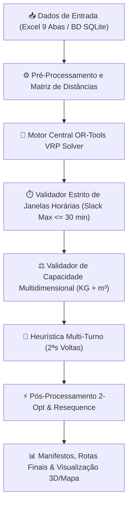

# 🚚 GeoRoutePlan — Motor de Planeamento e Otimização de Rotas (VRP Engine)

Este documento descreve detalhadamente a arquitetura, regras de negócio, restrições matemáticas e o funcionamento operacional do **Motor de Planeamento de Rotas do GeoRoutePlan**.

---

## 🧭 1. Visão Geral da Arquitetura

O motor de planeamento é baseado numa abordagem híbrida que combina o poder exato do **Google OR-Tools Routing Solver (Vehicle Routing Problem with Time Windows - VRPTW)** com heurísticas locais de pós-otimização (**2-Opt**, **Squeeze Insertion** e **Dynamic Load Tracking**).

---

## 🎯 2. Objetivos de Otimização (Função de Custo)

O algoritmo procura uma solução global que minimize simultaneamente três dimensões de custo operacional:

1. **Minimização de Distância Rodoviária:**
   - Cálculo de percursos com base numa matriz de distâncias calibrada (Haversine com fator de correção rodoviária `ROAD_FACTOR = 1.30` ou matriz OSRM local).
   - Eliminação de cruzamentos desnecessários e agrupamento geográfico compacto (*density clusters*).

2. **Minimização de Custos Financeiros Diretos (€):**
   - Utilização do custo por quilómetro (`Custo_KM`) específico de cada viatura.
   - Utilização do custo por hora de operação (`Custo_Hora`) do motorista e da viatura.
   - O algoritmo prioriza preencher primeiro as viaturas mais económicas antes de acionar viaturas de maior custo operacional.

3. **Maximização da Eficiência de Frota:**
   - Redução do número de veículos necessários em estrada para cumprir 100% dos serviços do dia.

---

## 🛡️ 3. Restrições Rígidas de Capacidade (Hard Capacity Constraints)

Nenhuma rota é gerada ou aprovada se violar qualquer um dos limites físicos das viaturas:

### A. Limite de Peso (`Capacidade_KG`)
- A soma do peso de todas as entregas a bordo nunca pode exceder a carga útil máxima da carrinha ou camião.

### B. Limite de Volume (`Capacidade_Vol` em m³)
- O somatório da cubagem das caixas e paletes não pode exceder o volume do baú da viatura.

### C. Número Máximo de Paragens (`Max_Entregas`)
- Respeita o limite diário de clientes por turno estabelecido na ficha da viatura (ex: 20 a 35 paragens), prevenindo a sobrecarga e a fadiga do motorista.

### D. Operações Mistas (Carga Dinâmica ao Longo da Rota)
O motor suporta três tipos operacionais com cálculo contínuo de balanço de carga:
- **Entrega (Dropoff):** Reduz o peso e volume da viatura à medida que avança na sequência.
- **Recolha / Devolução (Pickup):** Acrescenta carga no compartimento a meio da rota, garantindo que o teto da viatura nunca é ultrapassado em nenhum ponto do trajeto.
- **Troca Simutânea (Pickup & Delivery):** Descarrega a mercadoria nova e recolhe o retorno no mesmo cliente com validação imediata de espaço e peso remanescentes.

---

## ⏱️ 4. Gestão Rigorosa de Janelas Horárias (VRPTW Estrito)

O planeamento respeita as disponibilidades de receção dos estabelecimentos e as jornadas de trabalho dos motoristas sem paragens injustificadas.

### A. Cumprimento dos Horários dos Clientes
- **Entregas Matinais** (ex: `09:00 - 13:00`): São programadas obrigatoriamente durante a manhã.
- **Entregas Vespertinas** (ex: `14:00 - 18:00`): São programadas durante a tarde ou numa 2ª volta.

### B. Proibição de Espera Prolongada (`MAX_WAIT_SLACK_SEC = 1800`)
- **Regra dos 30 minutos:** A folga de espera máxima admissível entre a chegada e a abertura do cliente está limitada a **30 minutos**.
- **Comportamento proibido:** O carro **nunca** é programado para chegar às 07:33 a um cliente que abre às 14:00 para ficar 6 horas e meia parado. Caso a viatura não consiga chegar dentro da janela (ou com no máximo 30 min de antecedência), a entrega é movida para uma rota da tarde, para a 2ª volta ou reportada como pendente por incompatibilidade horária.

### C. Tempos de Serviço e Descarga (`Tempo_Descarga_Min`)
- Cada paragem contempla o tempo real necessário para descarga, conferência de fatura e assinatura da guia (ex: 10 a 20 minutos por cliente).

### D. Turno de Trabalho da Viatura
- Cada rota inicia após a `Hora_Inicio_Turno` (ex: `06:30` ou `08:00`) e tem de regressar ao armazém antes da `Hora_Fim_Turno` (ex: `17:00` ou `18:00`).

---

## 🔄 5. Operação em 2ª Volta (Multi-Trip no Mesmo Dia)

Para empresas com frotas reduzidas ou entregas com horários diferenciados, o motor suporta a ativação da opção **`2ª Volta = Sim`**:

1. **Turno Dividido:** O mesmo veículo e motorista executam duas rotas no mesmo dia.
2. **Ciclo da 1ª Volta:** Sai de manhã, atende as entregas matinais e regressa ao armazém central.
3. **Tempo de Recarga:** O sistema soma o tempo de cais no armazém (30 a 45 minutos) para descarregar eventuais devoluções e carregar a mercadoria da tarde.
4. **Ciclo da 2ª Volta:** Arranca automaticamente após o carregamento para cumprir as entregas da tarde (`14:00 - 18:00`), garantindo o regresso final ao armazém dentro da jornada de trabalho.

---

## 🏷️ 6. Matriz de Regras e Restrições de Negócio

O sistema aplica um validador de compatibilidade cruzada entre a viatura e o local de entrega:

| Tag do Veículo | Permissão | Tag da Entrega | Resultado Operacional |
| :--- | :---: | :--- | :--- |
| `[SEM_FRIO]` | **PROIBIR** | `[FRIO]` | A viatura sem frio nunca recebe produtos perecíveis. |
| `[PESADO_19T]` | **PROIBIR** | `[ACESSO_RESTRITO_LX]` | Camiões pesados são impedidos de entrar em zonas históricas/estreitas. |
| `[CARRINHA_PEQUENA]` | **PERMITIR** | `[ACESSO_DIFICIL]` | Apenas viaturas ligeiras recebem clientes em zonas de difícil manobra. |

---

## 🏠 7. Suporte Multi-Armazém

1. **Afiliação Geográfica:** Cada encomenda é associada ao respetivo armazém de abastecimento (`Armazem`).
2. **Retorno Garantido:** Cada rota começa e encerra no armazém correto de origem.
3. **Foco Visual no Armazém Ativo:** Quando apenas um armazém tem carga nesta distribuição, o mapa e o algoritmo focam-se 100% nesse centro de distribuição, ignorando armazéns vazios ou de outras regiões/ilhas.

---

## ⚡ 8. Pós-Processamento e Ordenação Tática

Após a solução global gerada pelo OR-Tools, o utilizador tem ao dispor ferramentas táticas no ecrã de planeamento:

- **Botão "⚡ Ordenar Trajeto":** Reordena qualquer rota individual recorrendo a um algoritmo sequencial calibrado com forte penalização por violação de janelas horárias.
- **Auditoria Automática de Conformidade:** Verifica se alguma alteração manual excedeu o peso, volume ou horário limite, alertando o gestor de tráfego a cores (Verde = Conforme, Vermelho = Violação).
- **Cálculo Imediato de Manifestos:** Atualiza em tempo real os KM totais, tempos de condução, tempos de espera, taxa de ocupação em peso (%), taxa de ocupação em volume (%) e custo financeiro total (€).

---

## 🧠 9. Estratégia Futura: Decisão Ativa por Trânsito Preditivo CP7 (Corredores Horários)

O trânsito preditivo não deve ser uma métrica calculada apenas no fim da rota, mas sim o **critério decisor ativo no momento exato em que o solver escolhe se uma entrega vai para a Viatura A ou para a Viatura B**.

### A. O Problema da Decisão Puramente Geométrica
- Um cliente pode estar a apenas **5 km** do Carro A, mas exigir atravessar um nó de estrangulamento às 08h30 (ex: 2ª Circular / VCI) que demora **28 minutos**.
- O Carro B pode estar a **7 km**, mas a circular por um corredor fluido no sentido contrário, demorando apenas **11 minutos**.
- **Comportamento Inteligente:** O solver escolhe o **Carro B**, garantindo a chegada antecipada sem queimar tempo de motor em marcha lenta e sem violar a janela do cliente.

### B. Arquitetura da Tabela de Trânsito por CP7 (`perfil_transito_cp7`)
- **Sem explosão de dados ($N \times N$):** Em vez de calcular todos os pares de ruas, a base de dados em SQLite armazena o perfil de penalização percentual por Código Postal CP7 (~350.000 CP7s reais em Portugal) nas 24 horas do dia.
- **Tamanho compacto:** Ocupa menos de **250 MB**, com pesquisas instantâneas em memória RAM (< 1 ms).
- **Alimentação Orgânica a Custo Zero:** 
  1. Pelas rotas finais validadas pontualmente com APIs gratuitas (ex: 250.000 chamadas/mês da HERE ou créditos da Google).
  2. Pela telemetria GPS em tempo real da nossa própria **App de Motoristas** no terreno.
- **Corredores de Travessia:** O tempo de trânsito entre dois nós herda o perfil horários dos CP7s do corredor rodoviário em tempo real de decisão, forçando a criação de rotas organicamente imunes a engarrafamentos.

